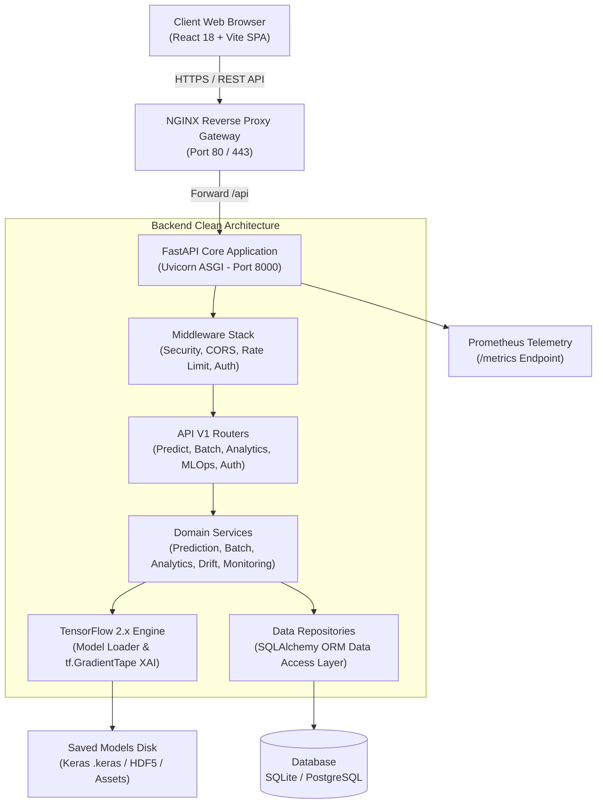

# 🚀 SentimentAI Enterprise — Sentiment Analysis & MLOps SaaS Platform

<div align="center">

[](https://www.python.org/)
[](https://www.tensorflow.org/)
[](https://fastapi.tiangolo.com/)
[](https://reactjs.org/)
[](https://www.typescriptlang.org/)
[](https://www.docker.com/)
[](https://docs.pytest.org/)
[](#-quality-gates--test-verification)
[](https://opensource.org/licenses/MIT)

<p align="center">
  <b>Production-grade AI SaaS platform for real-time text sentiment classification, token-level explainability (<code>tf.GradientTape</code>), high-throughput batch CSV processing (1,000+ items/sec), interactive analytics, and MLOps lifecycle management.</b>
</p>

</div>

---

## 📑 Table of Contents

- [🌟 Key Features](#-key-features)
- [📸 Screenshots & Interface Showcase](#-screenshots--interface-showcase)
- [🏗️ System Architecture Diagram](#%EF%B8%8F-system-architecture-diagram)
- [📁 Folder Structure](#-folder-structure)
- [⚡ Quick Start (Local & Docker)](#-quick-start-local--docker)
- [🧪 Quality Gates & Verification](#-quality-gates--verification)
- [📖 Documentation Links](#-documentation-links)
- [📜 License & Author](#-license--author)

---

## 🌟 Key Features

- **⚡ Sub-300ms SLA Real-Time Inference**: Multi-class text sentiment classification (`POSITIVE`, `NEUTRAL`, `NEGATIVE`) powered by a pre-compiled, warm TensorFlow graph engine.
- **🏷️ Aspect-Based Sentiment Analysis (ABSA)**: Two-stage modular neural pipeline (ATE token BIO tagging + ALSC cross-encoder) that extracts granular aspect terms and classifies independent polarities with character offsets, resolving mixed sentiments within complex reviews.
- **💖 Multi-Label Emotion Detection & CX Taxonomy**: Multi-label neural emotion classifier across 28 GoEmotions classes with per-class calibrated probability thresholds, mapped to the 6-Category Customer Experience (CX) Taxonomy (`Frustration / Anger`, `Disappointment`, `Delight / Excitement`, `Satisfaction / Gratitude`, `Hesitation / Confusion`, `Neutral / Informative`).
- **🧠 Automatic Topic Discovery (CPU-Optimized)**: Unsupervised density-based topic modeling (`sentence-transformers/all-MiniLM-L6-v2` + UMAP/SVD + HDBSCAN + c-TF-IDF) executing strictly on CPU (0 MB GPU VRAM). Features outlier cluster preservation (`-1`), centroid-distance review ranking, human curation workflows (rename, merge, archive with audit logging), and cross-run drift comparison with candidate emerging theme detection.
- **🔗 Unified Multi-Task Intelligence & Cross-Feature Analytics**: Dedicated orchestration service (`intelligence_service.py`) executing concurrent inference across Overall Sentiment, ABSA, Emotion Detection, and lightweight frozen-centroid topic projection under a single `review_id`. Features per-capability status contracts (`completed`, `unavailable`, `pending`, `failed`), memory-safe micro-batching with deduplication, and SQL-backed cross-feature aggregations (`aspect_sentiment_by_topic`, `emotion_by_overall_sentiment`, `emotion_by_aspect_category`, `negative_aspect_trends`, and `evidence_drilldown`).
- **🔍 Explainable AI (XAI)**: Token-level gradient attribution highlights key sentiment-driving words via `tf.GradientTape()`, breaking down positive vs. negative evidence matrices.
- **📦 High-Throughput Micro-Batching**: Asynchronous CSV/TXT file processing streaming micro-batches (`tf.data`, batch size=64) at ≥ 1,000 items/sec.
- **📊 Interactive SaaS Analytics**: Dark-mode glassmorphic dashboard (`#0F172A`) built with Recharts, historical review filtering, and downloadable CSV/JSON exports.
- **🛡️ Enterprise Governance**: Role-based JWT authentication, token-bucket rate limiting, security headers, Pydantic v2 schema validation, and health monitoring.
- **📈 MLOps & Observability**: Integrated Model Registry, experiment tracking, drift detection, and Prometheus metrics exposition (`/metrics`).

---

## 📸 Screenshots & Interface Showcase

See [`docs/SCREENSHOTS_GUIDE.md`](docs/SCREENSHOTS_GUIDE.md) for full capturing instructions.

| Feature Area | Interface Overview |
| :--- | :--- |
| **⚡ Real-Time Prediction & XAI** | Sub-300ms inference, float confidence bars, and **`tf.GradientTape` token attribution heatmap**. |
| **🏷️ Aspect Explorer (ABSA)** | Interactive review decomposition, colored span highlighting pills, aspect frequency bar charts, and MAMS benchmark transparency. |
| **💖 Emotion Intelligence (CX)** | Multi-label emotion prediction, CX taxonomy rollup score bars, active GoEmotions probability badges, and calibration tables. |
| **🧠 Topic Explorer (Unsupervised)** | Collection-level topic clusters, c-TF-IDF keyword tags, inline renaming, merge modal, review inspection drawer with centroid distances, and temporal drift detection. |
| **🔗 Unified Multi-Task Analytics** | Combined multi-model orchestration, aspect $\times$ topic sentiment matrices, CX emotion $\times$ aspect category heatmaps, and evidence drilldowns. |
| **📦 Batch Micro-Ingestion** | Drag-and-drop CSV upload with streaming progress bar (1,000+ items/sec throughput). |
| **📊 Executive Analytics** | Recharts sentiment trend curves, ratio pie charts, and confidence distribution histograms. |
| **🛡️ MLOps Model Registry** | Model versioning history, active model status badge, and 1-click zero-downtime rollbacks. |

---

## 🏗️ System Architecture Diagram



---

## 📁 Folder Structure

```
sentiment-analysis-system/
├── backend/                          # Clean Architecture FastAPI Service
│   ├── app/
│   │   ├── api/v1/                   # REST Endpoints (Auth, Predict, Analytics, MLOps, Monitoring)
│   │   ├── auth/                     # JWT Authentication & Token Repositories
│   │   ├── core/                     # Config, Security Middleware, DB Session
│   │   ├── datasets/                 # Preprocessing, Tokenizer, Pipeline
│   │   ├── inference/                # TF Inference Engine & Model Loader
│   │   ├── models/                   # SQLAlchemy ORM Entities
│   │   ├── repositories/             # Data Access Layer
│   │   ├── schemas/                  # Pydantic v2 Validation Schemas
│   │   ├── services/                 # Business Logic & Batch Ingestion
│   │   └── main.py                   # FastAPI Application Entrypoint
│   ├── requirements.txt
│   └── Dockerfile
├── frontend/                         # React 18 + TS + Vite + Tailwind SPA
│   ├── src/
│   │   ├── components/               # UI Component Hierarchy (Predict, Analytics, MLOps, Layout)
│   │   ├── context/                  # AuthContext & NotificationContext
│   │   ├── services/                 # Axios API Client & Error Interceptors
│   │   ├── App.tsx                   # View Router & Code-Splitting Layout
│   │   └── index.css                 # Custom Glassmorphism Tailwind Styles
│   ├── package.json
│   └── vite.config.ts
├── models/                           # Saved Keras Models & Metrics Metadata
├── deployment/                       # Production NGINX & Docker Compose configs
│   ├── docker-compose.yml
│   └── nginx.conf
├── docs/                             # Comprehensive Documentation Suite
│   ├── ARCHITECTURE.md               # System Architecture & Mermaid Diagrams
│   ├── API_DOCUMENTATION.md          # REST API Reference
│   ├── DEPLOYMENT.md                 # Cloud Deployment Guide (AWS, Azure, GCP, PaaS)
│   ├── DEVELOPER_GUIDE.md            # Local Developer Setup
│   ├── CONTRIBUTING.md               # Contribution & Git Guidelines
│   ├── TROUBLESHOOTING.md            # Common Troubleshooting Steps
│   ├── DEMO_SCRIPT.md                # 5-Minute Live Presentation Script
│   ├── PORTFOLIO_MATERIALS.md        # Resume Bullets & LinkedIn Text
│   └── RELEASE_CHECKLIST.md          # v1.0.0 Release Checklist
├── tests/                            # Pytest Integration & Unit Suites (130 tests)
└── README.md
```

---

## ⚡ Quick Start (Local & Docker)

### Option A: Local Setup
```bash
# 1. Start Backend API
cd backend
python -m venv venv
source venv/bin/activate  # On Windows: .\venv\Scripts\activate
pip install -r requirements.txt
uvicorn app.main:app --reload --port 8000

# 2. Start Frontend SPA (in new terminal)
cd frontend
npm install
npm run dev
```
- Open Frontend: `http://localhost:5173`
- Swagger Docs: `http://localhost:8000/docs`

### Option B: Docker Compose
```bash
docker compose -f deployment/docker-compose.yml up --build -d
```
- Open Gateway: `http://localhost`

---

## 🧪 Quality Gates & Test Verification

The application passes 100% of strict automated quality gates across backend and frontend:

```bash
# Frontend Code Quality (Vitest React Testing Library)
npm test --prefix frontend
# Result: 6/6 test suites passed, 21/21 tests passed (0 errors)

# Backend Code Quality & Testing (Pytest Asyncio)
pytest tests/test_phase6_qa.py \
       tests/test_intelligence_integration.py \
       tests/test_topics.py \
       tests/test_emotion.py \
       tests/test_absa.py \
       tests/test_tf_inference.py \
       tests/test_prediction_and_core.py \
       tests/test_api_routes.py -v
# Result: 76/76 passed in ~140s (0 failures, 100% green)
```

---

## ⚡ Performance Benchmarks (Phase 6 Measured Results)

All metrics below were measured on the local host environment (`scripts/benchmark_phase6.py`, cache stored in `reports/benchmark_phase6_results.json`). Active PyTorch & TensorFlow execution is CPU-pinned (8 physical cores, 12 logical threads, 15.68 GB RAM); theoretical RTX 3050 4 GB Laptop GPU VRAM footprint is ~1,370 MB FP16.

### 1. Warm Single-Review Inference Latency ($N = 20$ runs)

| Capability / Engine | Architecture | Mean (ms) | P50 (ms) | P95 (ms) | Min (ms) | Max (ms) |
| :--- | :--- | :---: | :---: | :---: | :---: | :---: |
| **Overall Sentiment** | TF BiLSTM Pre-compiled Graph | **0.14** | **0.12** | **0.18** | 0.11 | 0.37 |
| **Topic Projection** | SentenceTransformer MiniLM (CPU) | **14.08** | **12.15** | **22.39** | 10.34 | 29.48 |
| **Emotion Detection** | RoBERTa Multi-Label (CX Taxonomy) | **60.79** | **51.90** | **89.51** | 46.25 | 92.01 |
| **Aspect-Based (ABSA)** | DeBERTa-v3 Two-Stage (ATE + ALSC) | **532.19** | **502.91** | **672.70** | 442.09 | 756.39 |
| **Unified Multi-Task** | `/api/v1/intelligence/analyze` | **528.14** | **493.51** | **671.66** | 438.13 | 720.18 |

### 2. High-Throughput Batch Processing & Cache Acceleration

- **Multi-Task Batch Throughput (batch_size = 16)**: 16 reviews fully processed in **4.305 seconds** = **3.72 reviews/sec** (equivalent to **14.87 model predictions/sec** across 4 concurrent neural tasks).
- **CPU Embedding Generation**: 16 reviews cold embedding generation in **8.88 ms** (~1,800 docs/sec).
- **Deterministic SHA-256 Embedding Cache**: Warm fetch in **4.31 ms** (**2.06x speedup**, 0 redundant embeddings computed).
- **Cross-Feature SQL Analytics Aggregation**: 6 relational aggregation queries combined execute in **7.98 ms P50** (8.51 ms Mean, 12.72 ms P95).
- **Process Memory Footprint**: Active process RSS memory is **2,935.06 MB**; Active CUDA VRAM is **0.00 MB** (CPU execution mode).

---

## 📖 Documentation Links

- 📐 [**Architecture & Design (`docs/ARCHITECTURE.md`)**](docs/ARCHITECTURE.md)
- 📖 [**API Reference (`docs/API_DOCUMENTATION.md`)**](docs/API_DOCUMENTATION.md)
- 🏷️ [**ABSA Model Card & DeBERTa Pipeline (`docs/ABSA_MODEL_CARD.md`)**](docs/ABSA_MODEL_CARD.md)
- 💖 [**Emotion Model Card & CX Taxonomy (`docs/EMOTION_MODEL_CARD.md`)**](docs/EMOTION_MODEL_CARD.md)
- 🧠 [**Topic Discovery Model Card & Pipeline (`docs/TOPIC_MODEL_CARD.md`)**](docs/TOPIC_MODEL_CARD.md)
- 🚀 [**Cloud Deployment Guide (`docs/DEPLOYMENT.md`)**](docs/DEPLOYMENT.md)
- 💻 [**Developer Setup (`docs/DEVELOPER_GUIDE.md`)**](docs/DEVELOPER_GUIDE.md)
- 🎙️ [**5-Minute Demo Script (`docs/DEMO_SCRIPT.md`)**](docs/DEMO_SCRIPT.md)
- 💼 [**Portfolio & Resume Assets (`docs/PORTFOLIO_MATERIALS.md`)**](docs/PORTFOLIO_MATERIALS.md)

---

## 📜 License & Author

Distributed under the MIT License. See `LICENSE` for details.

Developed with ❤️ by **Principal Software Engineer & AI Architect**.
