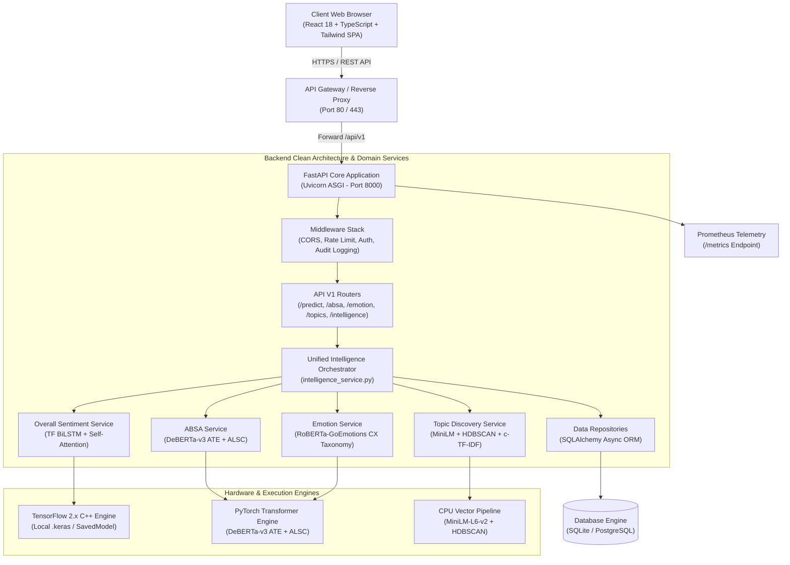
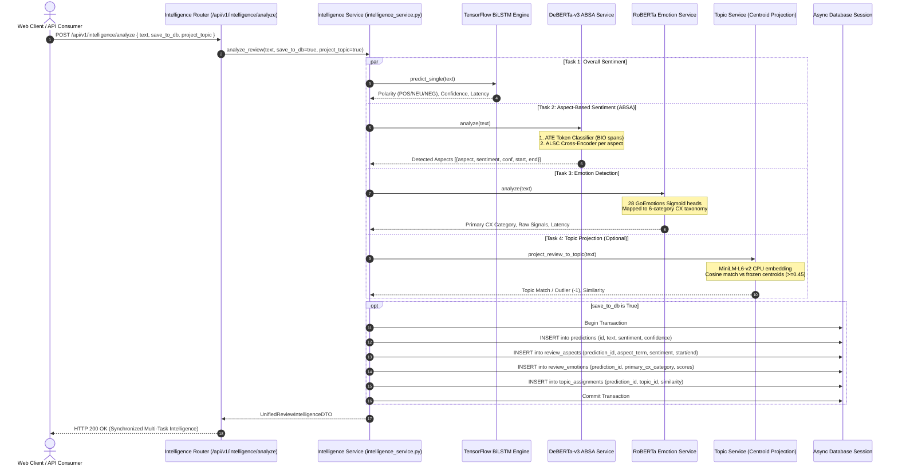
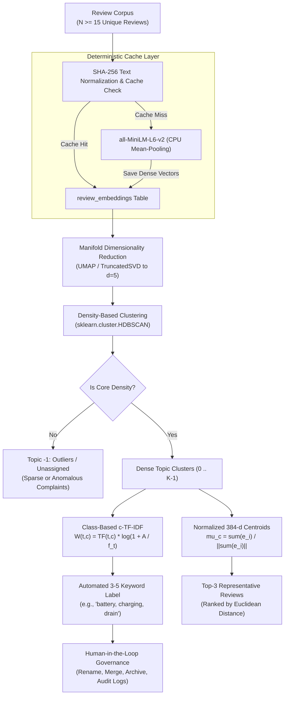

# 🏗️ SentimentAI Enterprise — Software Architecture & Design

This document details the architectural design, system boundaries, data flow, component interactions, and Clean Architecture patterns implemented in SentimentAI Enterprise across all 6 production phases.

---

## 1. 📐 System Context & Component Diagram



---

## 2. 🔁 Multi-Task Unified Review Pipeline (`/api/v1/intelligence/analyze`)

The platform integrates four distinct neural/statistical engines under a single transactional unit of work, strictly maintaining fault isolation and linking records under a unified `review_id` (`predictions.id`).



---

## 3. 🔍 Collection-Level Automatic Topic Discovery (`/api/v1/topics/discover`)

Unlike per-review classifiers, topic discovery is an unsupervised collection-level pipeline executed strictly on CPU ($0\text{ MB}$ GPU VRAM consumed):



---

## 4. 🏛️ Layered Clean Architecture

The platform strictly isolates responsibilities across 4 discrete layers:

```
+---------------------------------------------------------------------------------------+
|                                  PRESENTATION LAYER                                   |
|   FastAPI Routers: predict.py, absa.py, emotion.py, topics.py, intelligence.py        |
|   Strict Pydantic v2 Request/Response Validation, OpenTelemetry Instrumentation       |
+---------------------------------------------------------------------------------------+
                                           |
                                           v
+---------------------------------------------------------------------------------------+
|                             INTELLIGENCE ORCHESTRATION LAYER                          |
|   intelligence_service.py:                                                            |
|   - Multi-task coordination with independent capability fault isolation               |
|   - Micro-chunked batch processing (<=16 GPU batch, <=32 CPU embeddings)             |
|   - Real-time frozen centroid cosine projection (>=0.45 threshold)                   |
|   - Cross-feature SQL aggregation analytics (aspect x topic x emotion x sentiment)    |
+---------------------------------------------------------------------------------------+
                                           |
                                           v
+---------------------------------------------------------------------------------------+
|                                SPECIALIST DOMAIN SERVICES                             |
|   - tf_engine: TensorFlow 2.x BiLSTM, Self-Attention, GradientTape XAI                |
|   - absa_service: DeBERTa-v3 ATE Token Classifier + ALSC Cross-Encoder                |
|   - emotion_service: RoBERTa-GoEmotions Multi-Label Classifier (28 -> 6 CX Taxonomy)  |
|   - topic_service: MiniLM-L6-v2 CPU Embeddings, HDBSCAN, c-TF-IDF, Drift Detection    |
+---------------------------------------------------------------------------------------+
                                           |
                                           v
+---------------------------------------------------------------------------------------+
|                               DATA & INFRASTRUCTURE LAYER                             |
|   - SQLAlchemy 2.0 Async ORM with aiosqlite / asyncpg                                 |
|   - Tables: predictions, review_aspects, review_emotions, review_embeddings,          |
|             topic_discovery_runs, discovered_topics, topic_assignments, audit_logs     |
|   - Local Model Weights Disk: models/{absa,emotion,topics}/ (local_files_only=True)    |
+---------------------------------------------------------------------------------------+
```

---

## 5. 💻 Enterprise Frontend Architecture

The frontend is constructed with React 18, TypeScript, Tailwind CSS, Lucide icons, and Recharts, verified by Vitest and React Testing Library:

- **Review Intelligence Workbench (`ReviewIntelligence.tsx`):**
  - Interactive multi-span character-offset evidence highlighter with non-destructive slicing.
  - Aspect terms color-coded by sentiment with exact character boundaries.
  - Emotion category badge and radar/signal readout.
  - Frozen-centroid topic assignment badge with similarity score and distance to centroid.
  - Real-time telemetry strip (per-capability latency breakdown, model versions).
  - Batch review processor with progress indicator and deduplication metrics.

- **Cross-Feature Intelligence Analytics (`CrossFeatureAnalytics.tsx`):**
  - **Aspect $\times$ Discovered Topic Distribution:** Stacked horizontal/vertical bar chart and matrix table showing polarities per topic.
  - **Emotion $\times$ Overall Sentiment & Aspect Categories:** Heatmap/stacked distribution revealing psychological drivers of churn.
  - **Topic Summary Table:** Aggregated volume, sentiment ratio, and dominant CX emotion.
  - **Negative Aspect Trend Tracking:** Identifies emerging hardware/software defect trajectories over time.
  - **Sample Denominators & Guardrails:** Strict `n = ...` display and `Low Sample (n < 5)` warning badges on low-volume cells.
  - **Statistical Integrity Notice:** Explicit non-causal disclaimer footer.
  - **Slide-Over Evidence Drilldown Drawer:** Instant inspection of actual source review texts backing any analytics cell, dismissible via `Escape` key or backdrop click.
